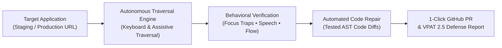

<p align="center">
  <picture>
    <source media="(prefers-color-scheme: dark)" srcset="public/logo.svg">
    
  </picture>
</p>

<h1 align="center">BarrierLens</h1>

<p align="center">
  <strong>Autonomous Agentic Web Accessibility Verification & Automated Code Remediation</strong><br />
  <em>Prove, verify, and resolve digital accessibility barriers before production code ships.</em>
</p>

<p align="center">
  <a href="http://43.205.254.136">
    
  </a>
</p>

<p align="center">
  <a href="https://www.w3.org/WAI/standards-guidelines/wcag/"></a>
  <a href="https://www.section508.gov/"></a>
  <a href="https://commission.europa.eu/business-economy-euro/doing-business-eu/accessibility-products-and-services/european-accessibility-act_en"></a>
  <a href="https://nextjs.org"></a>
  <a href="https://react.dev"></a>
  <a href="https://www.typescriptlang.org"></a>
</p>

---

## ⚡ Executive Overview

Over **96% of the top 1,000,000 websites fail basic digital accessibility standards**, creating severe compliance exposure under the **European Accessibility Act (EAA 2025)** and **ADA Title III**.

Traditional accessibility tooling leaves engineering teams exposed:
- **Passive DOM Linters:** Scan static HTML markup at initial page load. They cannot click buttons, navigate multi-step checkout funnels, press the <kbd>Tab</kbd> key, or verify modal focus traps.
- **Superficial Overlays:** Inject cosmetic CSS widgets that attempt to restyle client pages. They fail to solve core code defects, degrade user experience, and have been repeatedly rejected in US and EU federal courts.

**BarrierLens solves accessibility at the root cause.** Rather than passive string matching, BarrierLens evaluates live web applications by autonomously navigating interactive user journeys under real assistive constraints. It identifies behavioral barriers, produces cryptographic proof chains, and synthesizes tested source-code repairs ready for one-click GitHub Pull Requests.

---

## 🏛️ How BarrierLens Works



1. **Autonomous Behavioral Traversal:** Evaluates live dynamic states—opening modals, filling multi-step checkout forms, navigating nested menus, and testing keyboard escape handlers just like a human with assistive needs.
2. **Behavioral Verification:** Detects runtime traps that static linters miss:
   - **Keyboard Traps:** Identifies cyclical focus sinks where users cannot exit an interactive widget.
   - **Visual vs. Reading Order Inversions:** Detects spatial layout divergence where tabbing sequence does not match visual layout.
   - **Assistive Silence:** Pinpoints dynamic UI errors or toasts that appear visually without corresponding screen reader announcements.
3. **Automated Source-Code Remediation:** Generates surgical React and HTML code patches with zero regressions, ready to merge directly via GitHub Pull Requests.
4. **Certified Conformance Reporting:** Exports legally binding **VPAT® 2.5 (Revised Section 508 / EN 301 549 / WCAG 2.2 AA)** compliance documentation with cryptographic integrity hashes.

---

## 💎 Comparison Matrix

| Capability | Static Linters | Cosmetic Overlays | BarrierLens Platform |
| :--- | :---: | :---: | :---: |
| **Interactive Journey Navigation** | ❌ None (Static Snapshot) | ❌ None (DOM Toolbar) | ✅ **Full Autonomous Traversal** |
| **Keyboard Trap Detection** | ❌ Misses Dynamic Traps | ❌ Introduces New Traps | ✅ **Certified Focus Path Analysis** |
| **Reading Order Concordance** | ❌ Not Evaluated | ❌ Not Evaluated | ✅ **2D Spatial Layout Verification** |
| **Voice Speech Verification** | ❌ Static Attribute Only | ❌ Client TTS Hijack | ✅ **Live Announcement Stream Fidelity** |
| **Automated Source Code Fixes** | ❌ Documentation Links Only | ❌ Temporary CSS Monkey-Patch | ✅ **Tested Code Diffs & 1-Click PRs** |
| **Legal Compliance (EAA & ADA)** | ⚠️ Inadequate Defense | ❌ Rejected in Federal Court | ✅ **VPAT 2.5 Cryptographic Conformance** |

---

## 🚀 Quickstart

### Prerequisites
- Node.js 22.x or higher
- npm or pnpm

### 1. Clone & Install
```bash
git clone https://github.com/AadityaUniyal/BarrierLens.git
cd BarrierLens
npm install
```

### 2. Configure Environment
Create a `.env.local` file in the root directory:
```bash
cp .env.example .env.local
```

### 3. Run Development Server
```bash
npm run dev
```

Open [http://localhost:3000](http://localhost:3000) to view the Mission Control workspace.

---

## 🛠️ Production Build & Verification

```bash
# Run TypeScript compilation check
npx tsc --noEmit

# Compile production build
npm run build

# Start production server
npm start
```

---

## 📜 Compliance & Legal Defense

BarrierLens automates adherence to statutory global accessibility standards:
- **WCAG 2.2**: Conformance Levels A, AA, and AAA.
- **Section 508 / VPAT® 2.5**: Official Federal Information and Communication Technology (ICT) Conformance Reports.
- **European Accessibility Act (EAA 2025)**: Directive 2019/882 enforcement for digital products.
- **Americans with Disabilities Act (ADA Title III)**: Web accessibility compliance defense.

---

<p align="center">
  <sub>BarrierLens Enterprise Platform • Autonomous Accessibility Verification Engine</sub>
</p>
